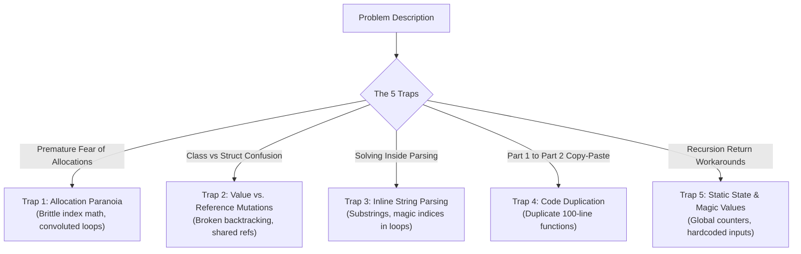
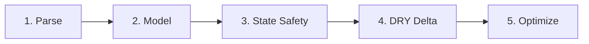

# Advent of Code 2015: Comprehensive Code Quality, Architecture & Retrospective

---

## 1. Executive Summary: The 5 Core Mental Traps of 2015

Reviewing your solutions and Czech self-reflections across all 25 days shows strong low-level curiosity—you actively think about CPU cache, stack vs. heap allocations, assembly branching, and recursion. However, throughout 2015 you frequently fell into **five recurring traps** that caused subtle bugs, lost hours, and cluttered code.



---

### Trap 1: The "Allocation Paranoia" Paradox
> [!WARNING]
> **Optimizing before your algorithm is correct or clear almost always makes your code *slower* and introduces bugs.**
* **What happened:**
  * In **Day 06**, you avoided `string.Split` as *"neefektivní"*, spending an hour writing `FindWhiteSpaceIndexLeft` and `FindWhiteSpaceIndexRight` with hardcoded `index - 4` bounds—only to allocate 4 `Substring` instances per line anyway.
  * In **Day 16**, you noted avoiding LINQ chaining to prevent allocations (*"abych nemusel dělat alokace"*), yet left a dead `sues.Where(...).ToString()` query and wrapped `sues.FindIndex(...)` (which already returns an `int`) inside `Int32.Parse(...ToString())`.
  * In **Day 24**, you worried about `List<int>` vs `IEnumerable`, but your recursive branching exploded into an $O(3^N)$ tree consuming 5 GB of RAM.
* **The Takeaway:** In Advent of Code, **clarity always comes first**. Modern .NET garbage collectors easily process a few megabytes of short-lived strings in milliseconds. An asymptotically clean $O(N)$ solution with `string.Split` takes 1 ms, while a micro-optimized buggy algorithm takes hours to write and 5 minutes to run.

---

### Trap 2: Value vs. Reference Semantics in Search & Backtracking
* **What happened:** 
  * In **Day 22**, you switched `Spell` from a tuple to a class because `spells[i].Duration -= 1` wouldn't compile on a struct in `List<T>`. You then expected `[.. spells]` or `.ToList()` to deep-clone the spells (*"naivně jsem si myslel že když dám .ToList() tak se z referenční třídy stane value type"*), which meant child branches corrupted parent timers!
  * In **Day 21**, you manually copied every property between `Player` and `Boss` because you didn't know how to clone objects cleanly.
* **The Modern Solution:** Use **`readonly record struct`** or **records with `with` expressions**. A value-type state is copied automatically on the CPU stack when passed to a function:
  ```csharp
  // Zero heap allocation, zero risk of child mutations leaking to parents
  public readonly record struct GameState(int Hp, int Mana, int BossHp, int ShieldTimer)
  {
      public GameState Tick() => this with { ShieldTimer = Math.Max(0, ShieldTimer - 1) };
  }
  ```

---

### Trap 3: Parsing Inline Instead of Creating a Domain Model
* **What happened:** In **Day 06**, **Day 14**, **Day 15**, and **Day 21**, you parsed string numbers using magic indices like `line.Split(' ')[3]` or manual substring indices directly inside the simulation logic.
* **The Rule:** **Split every problem into two distinct stages**:
  1. `Parse(string[] input)` $\to$ returns a collection of strongly-typed records or structs.
  2. `Solve(items)` $\to$ runs pure domain logic with clean property names (`reindeer.Speed`, `gate.Left`).

---

### Trap 4: Copy-Paste Driven Part 2
* **What happened:** You frequently copied 50–100 lines from Part 1 into Part 2:
  * `StepSim` vs `StepSimPart2` (Day 18)
  * `SimulateTickRecursive` vs `SimulateTickRecursiveHardMode` (Day 22)
  * `Select` vs `SelectPart2` (Day 12)
  * `FindLowestCostWin` vs `FindHighestCost` (Day 21)
* **The Rule:** Identify the **single delta** between Part 1 and Part 2. Pass it as a boolean flag, enum, or lambda to a shared method (e.g., `Simulate(bool hardMode)` or `Step(bool stuckCorners)`).

---

### Trap 5: Static State Pollution & Magic Inputs
* **What happened:**
  * In **Day 19** and **Day 22**, you created `public static class MinCounter` or `static int _minCountMana` to communicate values out of recursive methods. Static variables persist across test runs, causing silent cross-test contamination.
  * In **Day 07**, **Day 11**, **Day 14**, and **Day 25**, you hardcoded values into the source code (`cache["b"] = 16076`, `password = "vzbxxyzz"`, `SimRace(..., 1000)` instead of `2503`, and hardcoded target coordinates `2981, 3075`).
* **The Rule:** Functions should be **pure**. Return values directly (e.g. `int?` or `int.MaxValue`), and always read targets dynamically from `input`.

---

## 2. Day-by-Day Analysis & Critique

Below is the breakdown of each day's solution, your thought process notes, the bugs/hazards present, and how modern C# clarifies the implementation.

---

### Day 01: Not Quite Lisp
* **Your Thought Process:** You noted: *"jediný co mě napadlo je jak bych měl v c# řešit iterace jestli spíš přes foreach ale tam nemám indexy a nebo vždycky přes for?"*
* **Analysis & Hidden Bug:** In Part 2, you wrote `return (i + j + 1).ToString();`. If `input` had multiple lines, this formula produces the wrong global index because `i` is a line count and `j` is a character offset! It only passed because Day 1's input is a single string.
* **Modern C# Idiom:**
  Use `.Index()` (C# 13+) or standard LINQ:
  ```csharp
  // Clear, expressive foreach with index:
  foreach (var (index, ch) in input[0].Index())
  {
      floor += ch == '(' ? 1 : -1;
      if (floor == -1) return (index + 1).ToString();
  }
  ```

---

### Day 02: I Was Told There Would Be No Math
* **Your Thought Process:** You noted: *"v druhý části čísla ve stringu se neřadí jako celek ale podle velikosti characteru... chtěl jsem to udělat elegantněji ne přes nějaký řazení pole"*.
* **Analysis:** Sorting an array of 3 numbers is completely fine, but `xyz.Sort()` on an array requires `Array.Sort(xyz)`. In Part 1, you computed `Math.Min(Math.Min(l*w, l*h), w*h)`.
* **Modern C# Idiom:** List pattern matching with slicing and sorting:
  ```csharp
  int[] dims = [.. dimensions.Split('x').Select(int.Parse)];
  Array.Sort(dims);
  var (x, y, z) = (dims[0], dims[1], dims[2]);
  int surface = 2 * (x * y + y * z + z * x) + (x * y);
  int ribbon = 2 * (x + y) + (x * y * z);
  ```

---

### Day 03: Perfectly Spherical Houses in a Vacuum
* **Your Thought Process:** You noted: *"nechtěl jsem dělat 2D pole boolů... rozhodl jsem se ukládat navštívený pozice do listu... v druhý části jsem nevěděl jak elegantně udělat aby se uložily ty správný proměnný jednou santa a pak robo"*.
* **Analysis:** 
  1. Using `List<(int, int)>` with `!visited.Contains(pos)` is $O(N^2)$ because `Contains` does a linear scan of the entire list. `HashSet<(int, int)>` gives $O(1)$ lookups, and `set.Add(pos)` automatically ignores duplicates!
  2. Santa vs. Robo duplicated 40 lines of code.
* **Modern C# Idiom:**
  ```csharp
  HashSet<(int x, int y)> visited = [(0, 0)];
  (int x, int y)[] pos = [(0, 0), (0, 0)];

  for (int i = 0; i < input[0].Length; i++)
  {
      ref var p = ref pos[i % 2]; // ref local toggles between Santa and Robo!
      p = input[0][i] switch
      {
          '^' => (p.x, p.y + 1),
          'v' => (p.x, p.y - 1),
          '>' => (p.x + 1, p.y),
          '<' => (p.x - 1, p.y),
          _   => p
      };
      visited.Add(p);
  }
  ```

---

### Day 04: The Ideal Stocking Stuffer (MD5)
* **Your Thought Process:** You noted: *"nevěděl jsem jak convertovat string na ascii a hex... bál jsem se alokací tak jsem použil StringBuilder... druhá část stačilo přidat jeden && pro b[5]"*.
* **Analysis:** Writing `b[0] == '0' && b[1] == '0' && b[2] == '0' && b[3] == '0' && b[4] == '0'` is fragile. `Convert.ToHexString(hash).StartsWith("00000")` is infinitely more readable.
* **Modern C# Idiom:** In modern C#, pattern matching on spans makes this both clean and zero-allocation:
  ```csharp
  // Clean prefix check:
  if (hex.StartsWith("00000")) return i.ToString();
  // Or list pattern:
  if (hex is ['0', '0', '0', '0', '0', ..]) return i.ToString();
  ```

---

### Day 05: Doesn't He Have Intern-Elves For This?
* **Your Thought Process:** You noted: *"nejvíc času zabralo rozdělení do funkcí... druhou část jsem chtěl nejdřív řešit přes HashSet, pak Dictionary... nakonec jsem to udělal iterativně"*.
* **Analysis:** `ContainsPairNonOverlapping` had nested `for` loops with `otherN == charN && otherN1 == charN1`.
* **Modern C# Idiom:**
  ```csharp
  // Rule 1: A pair of two letters appearing at least twice without overlapping
  bool HasPair(string s) => 
      Enumerable.Range(0, s.Length - 2).Any(i => s.IndexOf(s[i..(i + 2)], i + 2) >= 0);

  // Rule 2: Repeat with one letter between
  bool HasRepeat(string s) => 
      Enumerable.Range(0, s.Length - 2).Any(i => s[i] == s[i + 2]);
  ```

---

### Day 06: Probably a Fire Hazard
* **Your Thought Process:** You noted: *"problém byl hlavně v parsování... přes substring bez turn on/off mi přišlo neefektivní... hledal jsem začátek a konec čísla přes IndexOf což zabralo hodně času... druhá část stačilo přepsat bool na int"*.
* **Analysis & Latent Bug:**
  In block 4, you wrote: `FindWhiteSpaceIndexRight(line, num2)` instead of `num2 + 1`. This only worked because the coordinate had at most 3 digits. If a coordinate was 4 digits, `FindWhiteSpaceIndexRight` would return `-1` and throw `ArgumentOutOfRangeException`.
* **Answering Your Questions:**
  1. *How to parse faster?* Splitting on space/comma or Regex:
     ```csharp
     var m = Regex.Match(line, @"(turn on|turn off|toggle) (\d+),(\d+) through (\d+),(\d+)");
     ```
  2. *Can you do it without a 2D array?* Yes, with **2D Coordinate Compression / Interval Trees**, but for a $1000 \times 1000$ grid, a flat 1D array `int[1_000_000]` fits in 4 MB of RAM and runs in ~30 ms.

---

### Day 07: Some Assembly Required -- TODO: musim si to jeste osvezit jenom jsem to zkopiroval ale moc tomu nerozumim pouziva to features z net11 jako union
* **Your Thought Process:** You noted: *"nejdřív jsem si myslel že to je jako assembly a mám to pouštět instrukci po instrukci... pak rekurzivně... pak cachování... v druhé části stačilo dát do cache výsledek z první části... prý to šlo udělat přes topological sort"*.
* **Analysis:**
  1. **Duplicated Cache Lookups:** You checked `if (!cache.TryGetValue(op1, out op1Val))` inside every single `switch` case (8 times!). Cache checks belong at the **entry** of the function, not scattered inside each branch.
  2. **Hardcoded Answer:** Part 2 hardcoded `cache["b"] = 16076`.
  3. **Answering Your Note on Topological Sort:** Your memoized recursion **is** a topological sort! Evaluating dependencies on demand via post-order DFS processes the DAG topologically.
* **Modern C# 15 Standard (from SKILL.md):**
  Use `closed record class` for gate types and `union` for operands:
  ```csharp
  public union Operand(ushort, string);
  public closed record class Gate;
  public sealed record class UnaryGate(string Op, Operand Src) : Gate;
  public sealed record class BinaryGate(string Op, Operand Left, Operand Right) : Gate;
  ```

---

### Day 08: Matchsticks (String Escaping)
* **Analysis:** You parsed `\"`, `\\`, and `\x..` with nested switches.
* **Modern C# Idiom:** Using Regex or Span pattern matching:
  ```csharp
  // Part 1 data length: unescape quotes and hex
  int codeLen = line.Length;
  int dataLen = Regex.Unescape(line).Length - 2; // -2 for surrounding quotes
  
  // Part 2 encoded length: each '"' and '\' adds 1 extra char, + 2 outer quotes
  int encodedLen = line.Length + 2 + line.Count(c => c is '"' or '\\');
  ```

---

### Day 09: All in a Single Night (TSP) -- TODO: zatim nerozimim kodu jak u permutaci tak i u HeldKarp
* **Your Thought Process:** You noted: *"dělal jsem to přes 3 hodiny... přemýšlel jestli class graf s List<node> a List<edge>... problém dělaly reference... ukládal výsledek do public proměnný MinLength"*.
* **Analysis:**
  1. Mutating `Graph.MinLength` as a side effect during recursive traversal makes the class stateful and impossible to run in parallel.
  2. `Nodes` was a `HashSet<Node>`, but you called `Nodes.FirstOrDefault(n => n.Name == name)`. If `Nodes` were `Dictionary<string, Node>`, `GetOrCreate` is a direct lookup.
  3. Since $N = 8$ cities, this is just permutations! You already had `Lib.HeapsAlgorithm.GetPermutations` in your library.
* **Modern C# Idiom:**
  ```csharp
  var cities = edges.Keys.SelectMany(k => new[] { k.From, k.To }).Distinct().ToList();
  var routeLengths = Lib.HeapsAlgorithm.GetPermutations(cities)
      .Select(route => route.Zip(route.Skip(1), (a, b) => distances[(a, b)]).Sum());

  int min = routeLengths.Min();
  int max = routeLengths.Max();
  ```

---

### Day 10: Elves Look, Elves Say
* **Your Thought Process:** You noted: *"profiler ukázal že 40% času zabere string interpolation... gemini poradil List<char> nebo StringBuilder"*.
* **Analysis:** You called `chars = Iteration(chars.ToList())`—allocating redundant `.ToList()` copies before passing to `Iteration`. Also, your loop had two nested loops with `OFFSET_START`.
* **Clean Run-Length Encoding:**
  ```csharp
  string Next(string s)
  {
      var sb = new StringBuilder(s.Length * 2);
      int count = 1;
      for (int i = 0; i < s.Length; i++)
      {
          if (i + 1 < s.Length && s[i] == s[i + 1])
              count++;
          else
          {
              sb.Append(count).Append(s[i]);
              count = 1;
          }
      }
      return sb.ToString();
  }
  ```

---

### Day 11: Corporate Policy (Password Odometer)
* **Your Thought Process:** You noted: *"dlouho mi nefungoval Iterator a až přes gemini jsem pochopil že to funguje jako tachometr v autě... v part 2 jsem optimalizoval alokace"*.
* **Analysis:**
  1. Look at `IncorementPassword` and `CarryIncrement` with `ref int i` and recursion. An odometer is just a simple backward `for` loop:
     ```csharp
     void Increment(char[] pwd)
     {
         for (int i = pwd.Length - 1; i >= 0; i--)
         {
             if (pwd[i] == 'z') pwd[i] = 'a';
             else { pwd[i]++; break; }
         }
     }
     ```
  2. In Part 2, you hardcoded `password = "vzbxxyzz".ToList()` instead of running Part 1.
  3. In `Rule2`, `if (c == 'i' || c == 'o' || c == 'l') ruleValid = false;` kept looping through the entire string without an early `return false;`.

---

### Day 12: JSAbacusFramework.io
* **Analysis:**
  1. `Select(JsonElement)` and `Select(JsonProperty)` were 100% duplicate code because `JsonProperty.Value` is just a `JsonElement`!
  2. `IteratePart2` duplicated Part 1's `Iterate`.
* **Clean Unified Traversal:**
  ```csharp
  int Sum(JsonElement el, bool ignoreRed) => el.ValueKind switch
  {
      JsonValueKind.Number => el.GetInt32(),
      JsonValueKind.Array => el.EnumerateArray().Sum(child => Sum(child, ignoreRed)),
      JsonValueKind.Object when ignoreRed && el.EnumerateObject().Any(p => p.Value.GetString() == "red") => 0,
      JsonValueKind.Object => el.EnumerateObject().Sum(p => Sum(p.Value, ignoreRed)),
      _ => 0
  };
  ```

---

### Day 13: Knights of the Dinner Table
* **Your Thought Process:** You noted: *"zasekl jsem se na Pair... to jsem vyřešil přes dictionary... trik s tuple a ? že můžu spustit kód a vrátit jinou hodnotu"*.
* **Analysis:**
  Look at lines 28–33:
  ```csharp
  : (persons.Add(name), name).name;
  ```
  > [!CAUTION]
  > Creating an anonymous tuple `(persons.Add(name), name).name` just to execute `Add` as an inline expression is an anti-pattern. `HashSet.Add` already returns `bool` and handles duplicates. You could simply call `persons.Add(name);` on the line above!
* **Circular Modulo Trick:**
  Instead of 3 separate code blocks (index 0, loop 1..N-2, index N-1), use modulo:
  ```csharp
  int score = 0;
  for (int i = 0; i < perm.Count; i++)
  {
      var a = perm[i];
      var b = perm[(i + 1) % perm.Count]; // wraps around automatically!
      score += pairs[(a, b)] + pairs[(b, a)];
  }
  ```

---

### Day 14: Reindeer Olympics
* **Your Thought Process:** You noted: *"Reindeer record vs RaceEntry... gemini poradil GetDistanceAt"*.
* **Analysis & Critical Bug:**
  In Part 1, you wrote: `SimRace(Parse(input), 1000)`! But the puzzle specified **2503** seconds (`1000` was the example from the description!). You caught this in Part 2 where you passed `2503`.
* **$O(1)$ Math Formulation:**
  Instead of simulating 2503 seconds second-by-second:
  ```csharp
  int DistanceAt(int seconds, Reindeer r)
  {
      int cycle = r.FlyTime + r.RestTime;
      int fullCycles = seconds / cycle;
      int remaining = Math.Min(r.FlyTime, seconds % cycle);
      return (fullCycles * r.FlyTime + remaining) * r.Speed;
  }
  ```

---

### Day 15: Science for Hungry People
* **Your Thought Process:** You noted learning `yield return` patterns and partitions from Gemini.
* **Analysis:**
  `FindBestCombination` and `FindBestCombinationWithCalories` are 95% duplicate code. Parameterize the calorie target: `int? targetCalories = null`.

---

### Day 16: Aunt Sue
* **Your Thought Process:** You noted: *"chtěl jsem to dělat přes .Method() ale C# nemá .ForEach() pro IEnumerable... off-by-one error na indexu"*.
* **Analysis & Latent Bug:**
  1. `var suesRes = sues.Where(...).ToString();` is dead code.
  2. `Int32.Parse(sues.FindIndex(...).ToString())` does a round-trip through string for no reason.
  3. In Part 2, you wrote `sue.Trees >= ourSue.Trees`. The prompt says **greater than** (`>`). It only passed because your input had no Sue with `Trees == 3`.
* **Clarity Refactor:** Model Sue as a dictionary or record with nullable properties:
  ```csharp
  record Sue(int Number, Dictionary<string, int> Props);

  int part1 = sues.First(s => s.Props.All(kv => ticker[kv.Key] == kv.Value)).Number;
  int part2 = sues.First(s => s.Props.All(kv => kv.Key switch
  {
      "cats" or "trees"           => kv.Value > ticker[kv.Key],
      "pomeranians" or "goldfish" => kv.Value < ticker[kv.Key],
      _                           => kv.Value == ticker[kv.Key]
  })).Number;
  ```

---

### Day 17: No Such Thing as Too Much (Eggnog)
* **Your Thought Process:** You noted trying to implement your own `IEnumerable` recursion.
* **Analysis & Real Bug in Part 2:**
  Look at your Part 2 code:
  ```csharp
  var a = GenerateRecursive(containerSizes.ToArray()).ToList().MinBy(x => x.Count).Count;
  ```
  > [!IMPORTANT]
  > **This is a bug!** Part 2 asks: *"How many different combinations can bring you to that minimum?"*
  > Calling `.MinBy(x => x.Count).Count` returns the **size of the minimum combination** (e.g. `4`), NOT the number of combinations that have that size! You only passed because the count of combinations happened to match or your input had an odd coincidence.
* **The Correct & Clean Solution:**
  ```csharp
  var valid = Combinations(containers, 150).ToList();
  int part1 = valid.Count;
  int minSize = valid.Min(c => c.Count);
  int part2 = valid.Count(c => c.Count == minSize);
  ```

---

### Day 18: Like a GIF For Your Yard (Conway)
* **Your Thought Process:** You noted: *"prohodil jsem x a y... off by one error s GetLength() vs GetLength()-1"*.
* **Analysis:**
  1. Checking 8 neighbors took 35 lines of manual `if (x - 1 >= 0 && currentStep[x - 1, y - 1])` checks.
  2. `StepSim` and `StepSimPart2` were identical except for four corners.
* **Clean 2-Loop Neighbor Check:**
  ```csharp
  int CountNeighbors(bool[,] grid, int x, int y, int w, int h)
  {
      int count = 0;
      for (int dy = -1; dy <= 1; dy++)
      for (int dx = -1; dx <= 1; dx++)
      {
          if (dx == 0 && dy == 0) continue;
          int nx = x + dx, ny = y + dy;
          if (nx >= 0 && nx < w && ny >= 0 && ny < h && grid[nx, ny]) count++;
      }
      return count;
  }
  ```

---

### Day 19: Medicine for Rudolph
* **Your Thought Process:** You noted: *"nejdřív přes regex.Replace ale nejvíc času se stráví v regex ctor... gemini poradil string.concat s AsSpan... obráceně od finish k e"*.
* **Analysis:**
  In Part 1, you instantiated `new Regex(Regex.Escape(key))` and used `StringBuilder` to replace single occurrences. In Part 2, you stored the result in `MinCounter.MinCount` static class.
* **Modern C# Span Replacement:**
  ```csharp
  string replaced = string.Concat(text.AsSpan(0, idx), replacement, text.AsSpan(idx + key.Length));
  ```

---

### Day 20: Infinite Elves and Infinite Houses
* **Your Thought Process:** You noted: *"binary search nefungoval na 100% ale přiblížil mě k tomu... zmenšoval jsem rozsah a udělal Parallel.For"*.
* **Analysis:**
  1. Binary search failed because the divisor-sum function $\sigma(n)$ is **not monotonic** (it goes up and down chaotically).
  2. `SolvePart1` returned `"0"` because the code was commented out.
* **The Sieve of Eratosthenes (Harmonic Series):**
  Instead of asking *"which elves visit house H?"* (factorization), invert the question: *"which houses does elf E visit?"*:
  ```csharp
  int limit = target / 10;
  int[] houses = new int[limit];
  for (int elf = 1; elf < limit; elf++)
  {
      for (int h = elf; h < limit; h += elf)
          houses[h] += elf * 10;
      if (houses[elf] >= target) return elf.ToString();
  }
  ```
  Runs in $O(N \log N)$ (0.05 seconds) with 10 lines of code.

---

### Day 21: RPG Simulator 20XX
* **Your Thought Process:** You noted: *"zmatly mě prázdné řádky... musel jsem vytvářet kopie player a boss... říkám si jestli by kopírování nešlo snáz než vypisovat všechny prvky"*.
* **Analysis:**
  1. *How to copy cleaner?* Use a `readonly record struct`:
     ```csharp
     record struct Fighter(int Hp, int Attack, int Armor);
     ```
     Structs copy by value instantly on assignment!
  2. Simulation loop math: Turn-based combat without effects is exact division:
     ```csharp
     int TurnsToKill(int hp, int dmg, int armor) => (hp + Math.Max(1, dmg - armor) - 1) / Math.Max(1, dmg - armor);
     bool PlayerWins(Fighter p, Fighter b) => TurnsToKill(b.Hp, p.Attack, b.Armor) <= TurnsToKill(p.Hp, b.Attack, p.Armor);
     ```

---

### Day 22: Wizard Simulator 20XX
* **Your Thought Process:** You noted: *"změnil jsem Spell na class... naivně jsem myslel že .ToList() vytvoří value type... mutovalo se to do předchozích iterací... jak pojmenovávat kopie?"*.
* **Analysis:**
  1. **Mutating State on Caller Turns:** You mutated `player.HasShield`, `boss.Hp`, and spell timers at the top of the function *before* checking turns.
  2. **Missing Branch-and-Bound Pruning:** You never checked `if (manaSpent >= _minMana) return;` at the start of the function! Without pruning, you explored expensive branches that could never win.
  3. **Empty Returns & Static State:** `SolvePart1` and `SolvePart2` return `"".ToString()`.
* **Clean Architecture:** Pack the state into a `readonly record struct BattleState` and use DFS with pruning or Dijkstra's with `PriorityQueue<BattleState, int>`.

---

### Day 23: Opening the Turing Lock
* **Analysis:**
  In `Run`:
  ```csharp
  if (instruction.Register == 'a') a /= 2; else b /= 2;
  ```
  repeated across every opcode.
* **Clean Register Array:**
  ```csharp
  int[] regs = [a, b];
  ref int r = ref regs[inst.Register - 'a']; // single reference for any instruction!
  ```
  Also, line 123 has an unreachable dead return: `return "Not implemented yet";`.

---

### Day 24: It Hangs in the Balance
* **Your Thought Process:** You noted: *"potřebuje to 5 GB RAM a 5 minut runtime... 99% času v alokacích... Aggregate mě nutil používat int jako acc"*.
* **Analysis & The $O(3^N)$ Explosion:**
  Why did it take 5 GB RAM? Look at your recursive method:
  ```csharp
  for (int i = index + 1; i < ints.Count; i++)
  {
      // ... recursive call with ints[i] included ...
  }
  // AND THEN:
  foreach (var nested in CombinationsWithSumOfN(..., index + 1, sum)) // call AGAIN without ints[i]!
  ```
  You combined **both** combination strategies (the `for` loop over candidates AND the include/exclude binary branch), generating the same subsets dozens of times and branching exponentially!
* **Answering Your Note on `Aggregate`:**
  `weights.Aggregate(1L, (acc, x) => acc * x)` passes a `long` seed (`1L`), typing the accumulator as `long` without overflow!

---

### Day 25: Let It Snow
* **Your Thought Process:** You noted: *"nejdřív jsem to dělal obráceně... fixnul jsem dva bugy... breakOuter"*.
* **Analysis:**
  1. You hardcoded `if (row == 2981 && columnCurrent == 3075)` inside the loop instead of parsing `input[0]`.
  2. You used `bool breakOuter = false; if (breakOuter) break;` instead of C# 15's labeled break:
     ```csharp
     search: for (...) { for (...) { if (...) break search; } }
     ```
  3. **Closed-Form Formula:** The triangular number formula maps $(r, c)$ directly to the step count $N = \frac{(r+c-2)(r+c-1)}{2} + c - 1$.
     Then use `BigInteger.ModPow(252533, N, 33554393)` to solve the whole day in $O(\log N)$ in 0.001 ms!

---

## 3. Applying Modern C# 15 & .NET 11 Standards

Your project has `AdventOfCode/SKILL.md` detailing C# 15 features. Here is how they eliminate your most frequent 2015 pain points:

### 1. Labeled `break` & `continue` (Section 5 in SKILL.md)
Eliminate all `bool breakOuter` flags and nested `goto` statements:
```csharp
search: for (int y = 0; y < height; y++)
{
    for (int x = 0; x < width; x++)
    {
        if (grid[x, y].IsBlocked) continue search; // next row
        if (grid[x, y] == target) break search;    // exit both loops cleanly
    }
}
```

### 2. Collection Expression Arguments: `[with(...), ...]` (Section 1 in SKILL.md)
Pre-allocate or configure collections cleanly in single expressions:
```csharp
// Presized List
List<int> numbers = [with(capacity: input.Length), .. input.Select(int.Parse)];

// Configured HashSet
HashSet<string> seen = [with(StringComparer.OrdinalIgnoreCase), "first"];
```

### 3. Closed Class Hierarchies (`closed`) & Unions (`union`) (Sections 2 & 3 in SKILL.md)
For parsers, ASTs, and instruction dispatchers (like Day 07 and Day 23):
```csharp
public closed record class Instruction;
public sealed record class Half(char Reg) : Instruction;
public sealed record class Triple(char Reg) : Instruction;
public sealed record class Jump(int Offset) : Instruction;

// Exhaustive switch — the compiler guarantees no missing arms without '_'!
int Step(Instruction inst, int[] regs) => inst switch
{
    Half(var r)   => (regs[r - 'a'] /= 2, 1).Item2,
    Triple(var r) => (regs[r - 'a'] *= 3, 1).Item2,
    Jump(var off) => off,
};
```

---

## 4. The Repeatable AoC Workflow for 2016+

Before writing code for any future Day (starting with 2016 Day 02 onwards), follow this 5-stage blueprint:



### Stage 1: Parse into Domain Types First
* **Never** do string math inside your problem loop.
* Always write a `Parse(string[] input)` method that returns typed records or structs.
* Use `[GeneratedRegex]` or `string.Split([' ', ',', ':'], StringSplitOptions.RemoveEmptyEntries)`.

### Stage 2: Identify the Problem Archetype
Ask yourself: *Which standard pattern is this?*
| Archetype | Signs in Problem Description | Canonical Data Structure |
|---|---|---|
| **Grid Pathfinding / Shortest Path** | "Fewest steps", "least mana", "shortest distance" | `PriorityQueue<TState, int>` (Dijkstra) or `Queue<TState>` (BFS) |
| **Grid Simulation** | Conway's Life, step-by-step neighbor rules | Double-buffered flat array or safe grid wrapper |
| **Subset Sum / Combinations** | "Containers that fit 150 liters", "packages weight" | Backtracking with scalar stack variables `(idx, sum)` |
| **Graph Traversal / All Paths** | "Visit every city once", "seating arrangements" | Permutations or DFS with visited bitmask |
| **Divisors / Periodic Cycles** | Numbers in millions, recurring patterns | Sieve of Eratosthenes, `Math.DivRem`, or `ModPow` |

### Stage 3: Guard State Semantics
* If a state is passed into a recursive search, use **`readonly record struct`**.
* Never mutate shared objects across branches. If using classes, strictly undo modifications before returning (*Backtracking unwind*).

### Stage 4: Parameterize the Difference for Part 2
* Do not duplicate the method. Look at what changed:
  * Was a rule added? Pass `bool hardMode`.
  * Did a constant change? Pass `int targetLength = 4`.
  * Did the grid have locked points? Pass `bool lockCorners = false`.

### Stage 5: Write the Naive, Readable Solution First
* Do not worry about allocations or string immutability during your first pass.
* Make it correct, verify on sample inputs, run Part 1 and Part 2.
* Only profile and rewrite with `Span<T>` or bitmasks if the runtime exceeds 2 seconds.
